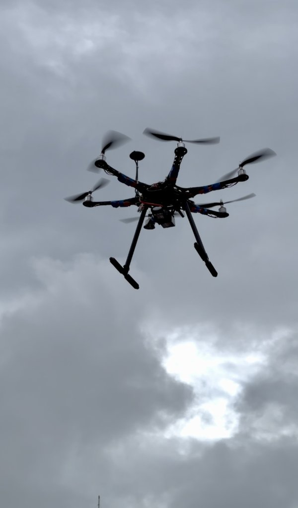
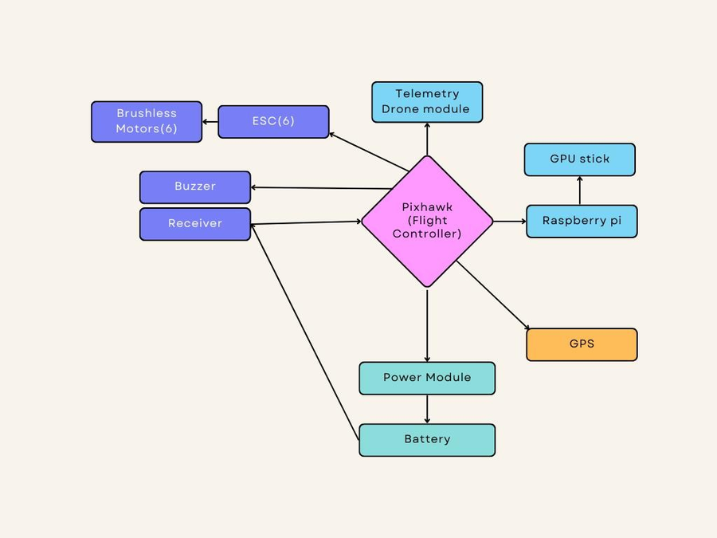
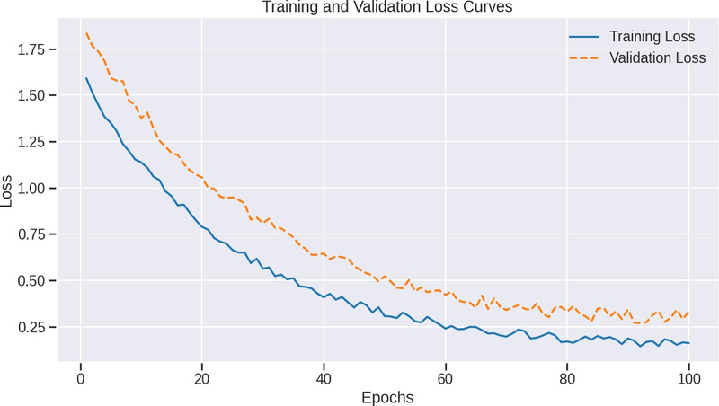
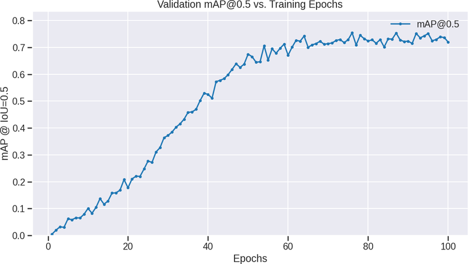
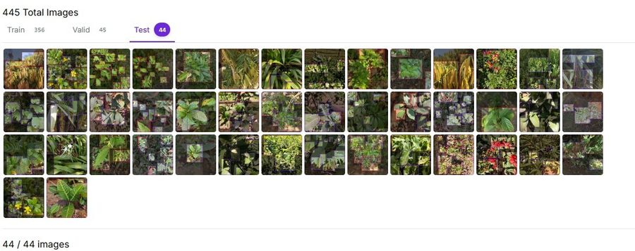

# AgroneX

[](https://github.com/Ankit02124/AgroneX/actions/workflows/tests.yml)

Hexacopter for precision farming. A Raspberry Pi 4 on the drone runs a YOLOv8n model on camera images of the crop, and when it finds diseased plants inside the field boundary it tells the Pixhawk flight controller to spray pesticide on that spot only.



B.Tech project at XIM University, Bhubaneswar (2025). The AgroneX team won 1st place at the ICAIET 2025 project exhibition and 3rd prize at the ETIA 2025 Industrial Conclave Student Expo.

## Problem statement

Farmers usually spray the whole field even when a disease is only in a few patches, which wastes chemicals, costs money and harms the soil and water. Most agricultural drones either scout or spray, not both, and the ones that detect disease send images to the cloud, which is slow or impossible in fields with poor mobile coverage.

AgroneX does both on one drone, with the detection running on board. It flies a survey mission, checks each camera frame for disease, and sprays only where disease is found, within about a third of a second and without an internet connection.

<br clear="right">

## Features

- **On-board disease detection:** YOLOv8n on a Raspberry Pi 4, accelerated with an Intel Movidius Neural Compute Stick (about 10 frames per second).
- **Hybrid transfer learning:** COCO -> PlantDoc (public dataset) -> 445 drone images we collected and labelled ourselves, to get a usable model from a small dataset.
- **Detect and spray in one flight:** a detection above the confidence threshold, inside a GeoJSON spray zone and with a good GPS fix, switches the pump relay through MAVLink (`MAV_CMD_DO_SET_RELAY`).
- **Autonomous missions:** Pixhawk 2.4.8 with ArduCopter, waypoint survey grids planned in Mission Planner.
- **Safe by design:** the Pi never flies the drone. The pump is switched off if the MAVLink link drops or the GPS degrades, and the Pixhawk failsafes (RC loss, low battery, geofence) always take priority.
- **Hexacopter airframe:** carries a 1.5 kg payload and can still land if one motor fails.
- **Logging:** every detection and pump event is logged with GPS position, plus an image for each spray.

## Tech stack

| area | used |
|---|---|
| deep learning | YOLOv8n (Ultralytics, PyTorch), transfer learning, TensorFlow Lite, OpenVINO |
| datasets | PlantDoc (public), own drone dataset labelled in Roboflow |
| edge computing | Raspberry Pi 4, Intel Movidius Neural Compute Stick, OpenCV, NumPy |
| flight | Pixhawk 2.4.8, ArduPilot (ArduCopter), Mission Planner, MAVLink (pymavlink), GPS/GNSS |
| hardware | carbon fibre hexacopter frame, BLDC motors, DShot ESCs, 4S LiPo, Radiolink AT10, SiK 915 MHz telemetry, diaphragm pump |
| languages | Python, YAML, GeoJSON |

## System architecture



The work is split between two computers on the drone:

- **Pixhawk** (flight controller): stabilisation, GPS navigation, waypoint missions, failsafes, and the pump relay on AUX OUT 1.
- **Raspberry Pi 4** (companion computer, connected to TELEM2): camera, YOLOv8n, the spray decision, and logging.

Each loop on the Pi:

1. Read the drone's position, GPS quality, mode and armed state from MAVLink.
2. If the drone is armed in AUTO or GUIDED mode, grab a frame and run YOLOv8n.
3. If a `disease` box is above 0.5 confidence, the position is inside a spray zone and the GPS fix is good, request a spray.
4. The pump runs for a 1.5 s burst and keeps running while disease is still being seen. It stops at once if the link or GPS is lost.

Parts list, wiring and payload notes: [docs/hardware.md](docs/hardware.md). ArduCopter parameters and checklists: [ardupilot/README.md](ardupilot/README.md).

## Installation

**Drone.** Build the hexacopter and wiring as in [docs/hardware.md](docs/hardware.md), flash ArduCopter and set the parameters in [ardupilot/README.md](ardupilot/README.md).

**Raspberry Pi 4** (Raspberry Pi OS, UART enabled, serial console disabled in `raspi-config`):

```
git clone https://github.com/Ankit02124/AgroneX.git
cd AgroneX/companion
sudo apt install python3-opencv
pip install -r requirements.txt
```

Copy the exported model to `companion/models/` (see [Dataset and models](#dataset-and-models)), draw your field boundary as a polygon (for example in geojson.io), save it as `companion/spray_zones.geojson`, and check `companion/config.yaml`.

To start automatically on boot:

```
sudo cp agronex.service /etc/systemd/system/
sudo systemctl enable --now agronex
```

## Usage

1. Power on the transmitter, then the drone. Wait for a 3D GPS fix.
2. Plan a survey grid over the field in Mission Planner and upload it.
3. Arm and switch to AUTO. The Pi starts detecting once the drone is armed in AUTO.
4. Watch the mission in Mission Planner. Pump events show in the Pi log.
5. After landing, read `companion/logs/flight_*.csv` (time, position, detections, pump on/off) and the saved `spray_*.jpg` frames.

Run the tests on a PC:

```
pip install numpy opencv-python-headless pyyaml pytest
pytest
```

## Project structure

```
companion/                  runs on the Raspberry Pi
├── main.py                 main loop: camera -> detection -> spray decision -> relay
├── detector.py             YOLOv8n inference (TFLite on CPU or OpenVINO on the Movidius stick), NMS
├── mavlink_link.py         MAVLink with the Pixhawk: vehicle state, relay command
├── spraying.py             spray zones (GeoJSON), confidence/GPS checks, pump timing and failsafe
├── config.yaml             serial port, model, thresholds, spray settings
├── spray_zones.geojson     field boundary
└── agronex.service         systemd unit
training/                   three-stage training and export (Ultralytics)
ardupilot/                  ArduCopter parameters and flight checklists
docs/                       hardware notes and images
tests/                      pytest for the spray logic and detection post-processing
```

## Dataset and models

| | |
|---|---|
| model | YOLOv8n |
| stage 1 | COCO pretrained weights |
| stage 2 | PlantDoc, an existing public dataset: about 2,600 field images of 13 crops with healthy and diseased leaves labelled |
| stage 3 | drone images collected and labelled by Ankit Choudhury and Ananya Verma: 445 photos (3060x3060), classes `healthy` / `disease`, split 356 / 45 / 44 |
| input size | 640x640 |
| on the drone | TensorFlow Lite on the Pi CPU, or OpenVINO FP16 on the Movidius stick |

The model weights are not in this repository because they were trained on our own field images. Training and export commands are in [training/README.md](training/README.md).

## Results

From our field tests and model evaluation:

**Model** (drone test set):

| mAP@0.5 | precision | recall | AP healthy | AP disease |
|---|---|---|---|---|
| 72.3 % | 0.725 | 0.80 | 0.785 | 0.665 |

YOLOv8n scored higher than R-CNN (54.3 %), YOLOv1/v2 (58 %) and Faster R-CNN (62 %) on the same data.

**On the drone:**

| | |
|---|---|
| inference on Raspberry Pi 4, CPU only | 350 ms per frame (2.8 FPS) |
| inference with the Movidius stick | 96 ms per frame (10.4 FPS) |
| image capture to pump command | 250-350 ms |
| flight time, camera payload | about 20 min |
| flight time, full 1.5 L sprayer | about 16 min |
| position hold (Loiter) | ±1-2 m horizontal |
| mission tracking (Auto) | within ±1.5 m of the planned path |
| test flights | 20+, about 5 hours |

Spray deposits were checked with water-sensitive paper during water-only spray tests. Simulated loss of the MAVLink link and of GPS quality both stopped spraying, and the Pixhawk failsafes overrode the Pi in every test.

| training loss | validation mAP@0.5 |
|---|---|
|  |  |

## Photos

<table>
  <tr>
    <td align="center"><br>AgroneX in flight</td>
    <td align="center"><br>system connections</td>
  </tr>
  <tr>
    <td align="center" colspan="2"><br>part of our drone dataset (Roboflow)</td>
  </tr>
</table>

## Future scope

- A larger drone dataset over more crops and seasons, and per-disease classes instead of only healthy / disease.
- Variable-rate spraying based on how much of the frame is diseased, with drift compensation from wind data.
- RTK GPS or visual-inertial odometry for centimetre-level spray placement.
- Obstacle avoidance for flying close to trees and poles.
- Longer flights: bigger batteries or a hybrid power system, and automatic return for battery swaps.
- Long-term field trials with a cost comparison against blanket spraying.

## Team

Built by Ankit Choudhury and Ananya Verma, under the guidance of Dr. Devendra Kumar Yadav, School of Computer Science and Engineering, XIM University. The competition entries were made by the larger AgroneX team.

PlantDoc: D. Singh et al., *PlantDoc: A Dataset for Visual Plant Disease Detection*, CoDS-COMAD 2020.

## License

Code: MIT ([LICENSE](LICENSE)).
