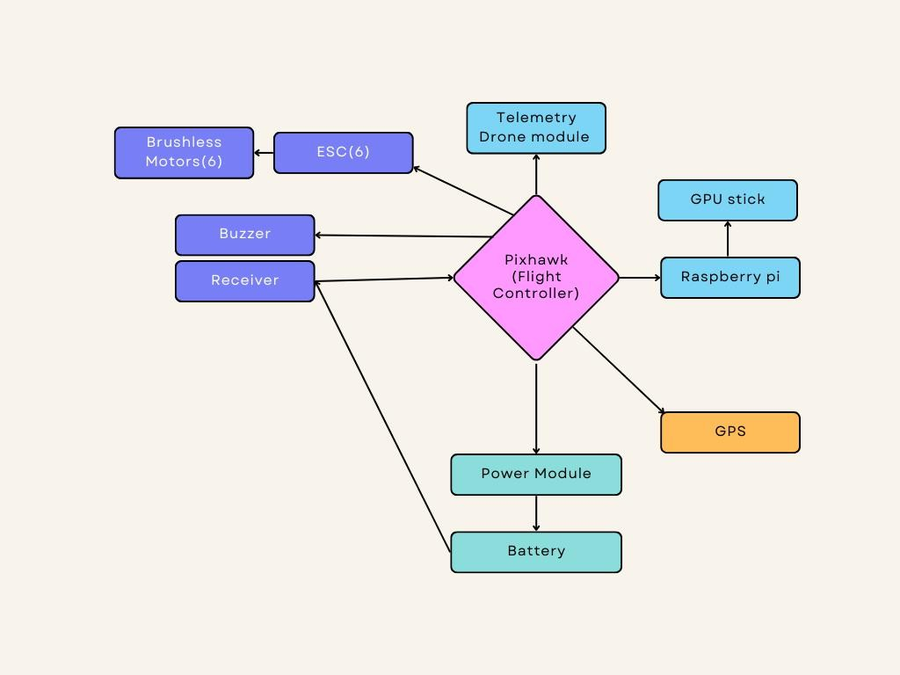

# Hardware

## Parts

| part | used | why |
|---|---|---|
| frame | carbon fibre hexacopter, Tarot 680 Pro class (680-750 mm motor to motor), foldable arms | six motors give more lift and can still land on five if one fails |
| motors | 6x brushless outrunner, ~400-480 KV, about 1.5 kg thrust each on 4S | thrust-to-weight above 2 at the full 4-4.5 kg take-off weight |
| propellers | 14-15 inch, 3 CW + 3 CCW, balanced | low-KV motors on 4S, efficiency over speed |
| ESCs | 6x 30 A, DShot600, mounted under the arms in the prop wash | 20-25 A peak per motor, no throttle calibration with DShot |
| flight controller | Pixhawk 2.4.8 running ArduCopter, on a vibration-damped mount | open firmware, failsafes, MAVLink |
| GPS | u-blox M8N with compass, on a raised mast | about ±2 m without RTK, compass away from power wires |
| battery | 4S 14.8 V 5200 mAh 35C LiPo (XT90) | 16-20 min flights |
| power | power distribution board + Pixhawk power module | battery voltage/current to the Pixhawk for the battery failsafe |
| RC | Radiolink AT10 transmitter + R12DS receiver (SBUS) | manual flying, mode switches, RTL on signal loss |
| telemetry | SiK 915 MHz radio pair | Mission Planner link, tested to 500 m |
| companion computer | Raspberry Pi 4 (Raspberry Pi OS) | camera, YOLOv8n, spray decisions |
| camera | 1080p Arducam (USB) | crop images |
| AI accelerator | Intel Movidius Neural Compute Stick on the Pi's USB | inference 350 ms -> 96 ms per frame |
| sprayer | 1.5 L tank under the centre of the frame, high-pressure diaphragm pump, flat-fan anti-drip nozzles, relay driven from a Pixhawk AUX output | tank in the middle so the centre of gravity does not move as it empties |

## Wiring

| from | to | notes |
|---|---|---|
| battery (XT90) | power module -> PDB | power module measures voltage and current |
| power module | Pixhawk POWER | 5 V for the Pixhawk |
| PDB | 6 ESCs, 5 V BEC for the Pi, pump driver | |
| ESC signals | Pixhawk MAIN OUT 1-6 | ArduCopter hexa X motor order |
| GPS + compass | Pixhawk GPS and I2C | |
| R12DS (SBUS) | Pixhawk RC IN | |
| SiK air radio | Pixhawk TELEM1 | Mission Planner, 57600 baud |
| Raspberry Pi UART (GPIO 14/15 + GND) | Pixhawk TELEM2 | MAVLink, 57600 baud |
| Pixhawk AUX OUT 1 | pump relay / MOSFET driver | RELAY1, switched by `MAV_CMD_DO_SET_RELAY` |
| Movidius stick, Arducam | Pi USB ports | |

The Pi only reads the vehicle state and switches the relay. Flying stays entirely on the Pixhawk, so if the Pi freezes the drone keeps flying its mission and the failsafes still work.

## Payload

The camera module (Pi, NCS, camera) weighs about 0.3 kg. The full sprayer with 1.5 L of liquid is the maximum payload of 1.5 kg, at which the hexacopter hovers at about 60-65 % throttle. Both payloads mount on the same rails, and the battery position is used to bring the centre of gravity back to the middle.
