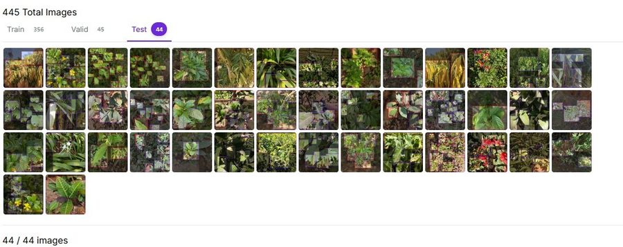
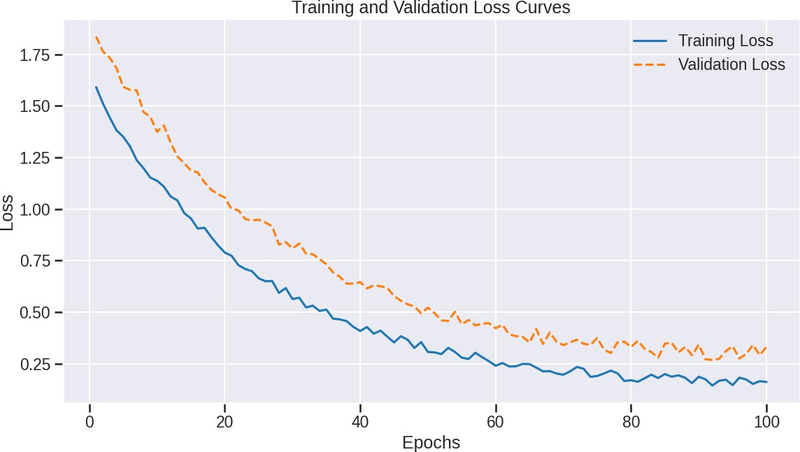
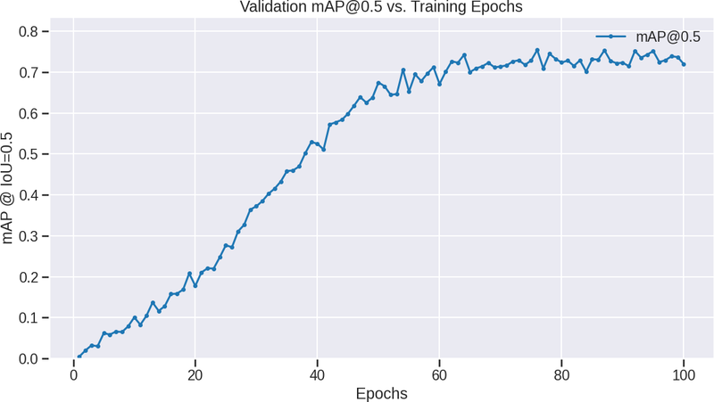
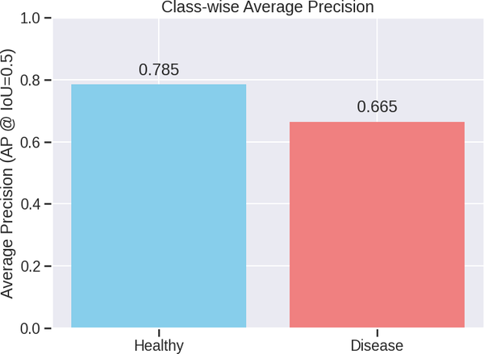

# Training the disease detector

## Why three stages

The drone dataset has only 445 images. Training YOLOv8n on that alone overfits quickly, so the model learns in three steps:

| stage | data | what it learns |
|---|---|---|
| 1 | COCO (Ultralytics `yolov8n.pt`) | general shapes, edges, textures |
| 2 | [PlantDoc](https://github.com/pratikkayal/PlantDoc-Dataset), about 2,600 field photos of 13 crops | what diseased and healthy leaves look like |
| 3 | own drone dataset, 445 images (3060x3060), classes `healthy` / `disease` | the top-down view, distance and lighting from the drone |

Stage 3 starts from the stage 2 weights with a 10x lower learning rate, so it adjusts the plant features instead of overwriting them.

## Drone dataset

Taken with the hexacopter over crops, annotated in Roboflow with bounding boxes. Split: 356 train, 45 validation, 44 test. Images are resized to 640x640 with letterboxing, and training uses mosaic, flips, rotation and brightness/colour augmentation because the dataset is small and lighting changes a lot between flights.



## Commands

```
pip install ultralytics
python training/train.py --stage plantdoc --data training/data/plantdoc.yaml
python training/train.py --stage drone --data training/data/drone.yaml --weights runs/detect/plantdoc/weights/best.pt
python training/export.py --weights runs/detect/drone/weights/best.pt --format tflite      # Pi CPU
python training/export.py --weights runs/detect/drone/weights/best.pt --format openvino    # Movidius stick
```

Training ran on an NVIDIA A1000 GPU, about 100 epochs per stage.

## Results (drone test set)

| metric | value |
|---|---|
| mAP@0.5 | 72.3 % |
| precision | 0.725 |
| recall | 0.80 |
| AP healthy / disease | 0.785 / 0.665 |

| loss | validation mAP@0.5 |
|---|---|
|  |  |



Compared on the same drone data during the project:

| model | mAP@0.5 |
|---|---|
| R-CNN | 54.3 % |
| YOLOv1/v2 | 58 % |
| Faster R-CNN | 62 % |
| **YOLOv8n** | **72.3 %** |

YOLOv8n was also the only one fast enough for the Raspberry Pi.
